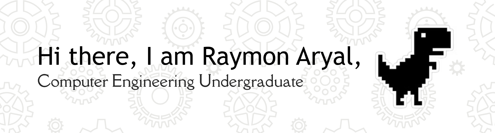

### Interests

- Programming (Data Structures and Algorithms)
- Pure Mathematics
- Science (Physics and its emerging recent trends)
- Machine Learning

 

## Tech Stack

## Currently Learning

## Connect with Me

- Discord: **reddwarfs**
- Facebook: **Raymon Aryal**

